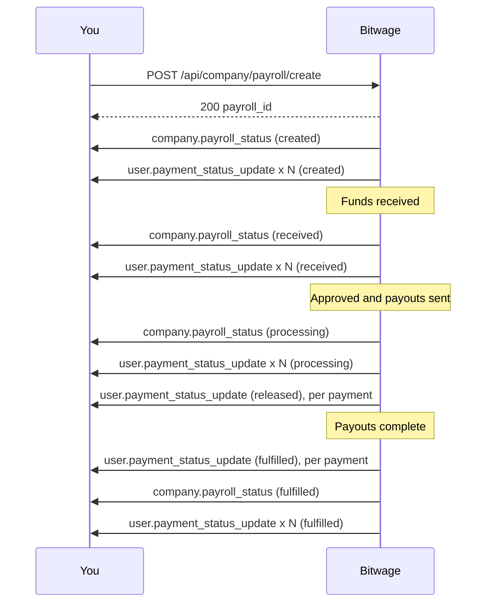

Bitwage sends webhook events as HTTP `POST` requests to the endpoint you
configure. Use them to track payrolls and payments through their lifecycle
instead of polling.

## Set up your webhook

1. Go to the **Webhooks** tab in your Bitwage Business Account settings.
2. [Create a webhook](https://app.bitwage.com/business/settings-page/webhook)
   with your endpoint URL and the events you want.
3. Save the **signing secret**. You need it to [verify signatures](#validate-webhook-signatures).

Webhooks are configured once on your own business account. You receive events
for your own company and for every company, user, and recipient you created
through the Partner API. Use `company_id` and `user_id` in each payload to tell
them apart.

## Events

| Event | Sent when |
|---|---|
| `company.payroll_status` | A payroll changes status. |
| `user.payment_status_update` | A payment in a payroll changes status. |
| `user.kyc_status_update` | A user's KYC status changes. |
| `company.kyc_status_update` | A company's KYB status changes. |
| `claim.detection` | A merchant claim is funded. |
| `wallet.request`, `wallet.deposit`, `wallet.lightning_deposit`, `wallet.crypto_withdrawal` | A balance account request, deposit, or withdrawal changes status. |

<Note>
  Creating a payroll with `POST /api/company/payroll/create` returns the
  `payroll_id` in the response. You then receive `company.payroll_status` every
  time the payroll's status changes, starting with `created`, and
  `user.payment_status_update` for every payment in it.
</Note>

## Webhook format

Every webhook is a `POST` with a JSON body and these headers:

| Header | Value |
|---|---|
| `Content-Type` | `application/json` |
| `x-bitwage-signature` | HMAC-SHA256 signature of the payload. |
| `x-bitwage-version` | `1.0` |

```json
{
  "event": "company.payroll_status",
  "data": { }
}
```

## Payroll and payment status

A payroll moves through these statuses. They are not strictly one-way:
reversing an action, for example un-receiving funds, sends the earlier status
again.

| Status | Meaning |
|---|---|
| `created` | The payroll exists and is waiting for funds. |
| `received` | Bitwage received the funding. |
| `processing` | The payroll is approved or released and payments are in flight. |
| `fulfilled` | Every payment is complete. |
| `canceled` | The payroll was canceled or deleted. |

A payment adds one more status, `released`: the payout has been sent to the
payout rail and is not yet complete.

### Which events fire when



Two things trigger `user.payment_status_update`, so you can receive several
events with the same `status` for one payment:

- **A payroll status change.** Bitwage sends one event per payment in the
  payroll, and `status` is the payroll's status (`created`, `received`,
  `processing`, `fulfilled`, or `canceled`).
- **A payment status change.** Bitwage sends one event for that payment, and
  `status` is `released`, `processing` (a release was reversed), or
  `fulfilled`.

### `company.payroll_status`

Sent when a payroll changes status. Each item in `payments` is a summary. Use
`user.payment_status_update` for per-payment detail.

```json
{
  "event": "company.payroll_status",
  "data": {
    "payroll_id": "1845638297730712",
    "company_id": "2693034771782348",
    "status": "received",
    "invoice_ids": null,
    "payments": [
      {
        "subpayroll_id": "9876543210",
        "user_id": "1234567890",
        "volume_input_in_input_currency": 500.0,
        "invoice_id": null
      }
    ]
  }
}
```

| Field | Description |
|---|---|
| `payroll_id` | The payroll. Matches `payroll_id` from the create response. |
| `company_id` | The paying company. |
| `status` | `created`, `received`, `processing`, `fulfilled`, or `canceled`. |
| `payments[]` | One item per payment: `subpayroll_id`, `user_id` (the recipient), `volume_input_in_input_currency`, and `invoice_id` when the payment is linked to a claim. |
| `invoice_ids` | Claim IDs linked to the payroll, or `null`. |

### `user.payment_status_update`

Sent when a payment changes status. It includes the full payment with its
outputs, the payouts that split the payment across the recipient's
distributions.

```json
{
  "event": "user.payment_status_update",
  "data": {
    "subpayroll_id": "9876543210",
    "claim_id": null,
    "user_id": "1234567890",
    "company_id": "2693034771782348",
    "status": "released",
    "payment": {
      "subpayroll_id": "9876543210",
      "receiver_user_id": "1234567890",
      "received": true,
      "received_at": "2026-11-10T16:02:11+00:00",
      "released": true,
      "released_at": "2026-11-10T18:30:45+00:00",
      "fulfilled": false,
      "fulfilled_at": null,
      "outputs": [
        {
          "input_currency": "USD",
          "output_currency": "BTC",
          "volume_input_in_input_currency": 500.0,
          "volume_output_in_output_currency": 0.005,
          "fees": 2.5,
          "spread": 0.0,
          "tx_hash": null
        }
      ]
    }
  }
}
```

| Field | Description |
|---|---|
| `subpayroll_id` | The payment. Use it as your idempotency key together with `status`. |
| `status` | `created`, `received`, `processing`, `released`, `fulfilled`, or `canceled`. |
| `user_id` | The recipient. |
| `company_id` | The paying company. |
| `claim_id` | The claim (invoice) this payment pays, or `null`. |
| `payment.received`, `released`, `fulfilled` | Booleans for each stage, with `*_at` timestamps once reached. |
| `payment.outputs[]` | One item per payout. `volume_output_in_output_currency` is what the recipient gets. `tx_hash` is set when a blockchain payout is sent. |

For a recipient you created, `outputs` includes only the payouts that go to
distributions you created for them.

### User and company verification

```json
{
  "event": "user.kyc_status_update",
  "data": {
    "user_id": "1234567890",
    "kyc_verification_status": "approved"
  }
}
```

```json
{
  "event": "company.kyc_status_update",
  "data": {
    "company_id": "2693034771782348",
    "kyc_verification_status": "approved"
  }
}
```

`kyc_verification_status` is one of `pending`, `approved`, `rejected`,
`unapproved`, or `neutral` (the case is in manual review).
`GET /api/companies/{company_id}/kyb` reports the same state as `draft`,
`pending_kyb`, `submitted`, `pending_review`, `approved`, or `rejected`.

### Claims

`claim.detection` is sent when funds for a merchant claim are detected.

```json
{
  "event": "claim.detection",
  "data": {
    "claim_id": "INV-1042",
    "company_id": "2693034771782348",
    "status": "detected",
    "currency": "USD",
    "amount": 150.0
  }
}
```

### Balance accounts

`wallet.request`, `wallet.deposit`, `wallet.lightning_deposit`, and
`wallet.crypto_withdrawal` share a base payload. `status` is `completed`,
`failed`, or `action_required`. A `failed` event always includes `error_code`
and `error_message`. Deposits and withdrawals add `transaction_id`, `currency`,
`amount` (a decimal string), `rail`, `tx_hash`, and fee fields. See the
**Balance account event** webhook in the API reference for the full schema.

## Delivery

- Bitwage sends each event **once**. It does not retry a failed delivery.
- Your endpoint has **20 seconds** to answer. Return `200` to acknowledge. Any
  other status, a timeout, or a connection error counts as a failed delivery.
- Redirects are not followed. The URL must be public `https` that resolves to a
  public address.
- Events are sent asynchronously, so they can arrive out of order, and you can
  receive duplicates.

Because delivery is not guaranteed:

- **Handle each event idempotently.** For payments, key on `subpayroll_id` plus
  `status`. For payrolls, key on `payroll_id` plus `status`.
- **Don't rely on order.** Compare the `*_at` timestamps in `payment`, or
  re-read the payroll.
- **Reconcile.** Use
  [`GET /api/company/{company_id}/payrolls/{payroll_id}`](/api-reference/company-payroll/get-payroll)
  to fetch the current status of a payroll and every payment in it, for example
  when a payroll hasn't changed status as long as you expect, or after your
  endpoint was down. It returns the same `status` values and `payment` objects
  as the webhooks.

## Validate webhook signatures

Verify signatures in production. The `x-bitwage-signature` header is the
hex-encoded HMAC-SHA256 of the message below, keyed with your signing secret.

```
message = endpoint_url + json_body
```

- `endpoint_url` is the URL you configured for the webhook, exactly as saved.
- `json_body` is the payload serialized with `json.dumps(payload, ensure_ascii=False)`
  in Python: keys in the order received, `", "` and `": "` separators, and
  non-ASCII characters not escaped.

### Python example

```python
import hashlib
import hmac
import json

SIGNING_SECRET = "whsec_..."  # from your webhook in the app
ENDPOINT_URL = "https://example.com/bitwage/webhooks"  # exactly as configured


def is_valid(raw_body: bytes, signature_header: str) -> bool:
    payload = json.loads(raw_body)
    message = ENDPOINT_URL + json.dumps(payload, ensure_ascii=False)
    expected = hmac.new(
        SIGNING_SECRET.encode("utf-8"),
        message.encode("utf-8"),
        hashlib.sha256,
    ).hexdigest()
    return hmac.compare_digest(expected, signature_header)


# In your handler:
#   is_valid(request.get_data(), request.headers["x-bitwage-signature"])
```

If you verify in another language, reproduce the serialization above. A
compact `JSON.stringify` output has no spaces after `,` and `:`, so it will not
match. Reject the request with `401` when the signature is missing or wrong.

## Best practices

- **Acknowledge fast.** Return `200` and process the event asynchronously.
- **Verify signatures** so you only act on webhooks from Bitwage.
- **Treat webhooks as hints, and the API as the source of truth** for money
  movement. Read the payroll before you release funds or mark an invoice paid.
- **Log `payroll_id` and `subpayroll_id`** so you can match events to your own
  records. `external_id` on payroll creation helps you look a payroll up later
  with `GET /api/company/{company_id}/payrolls?external_id=`.
